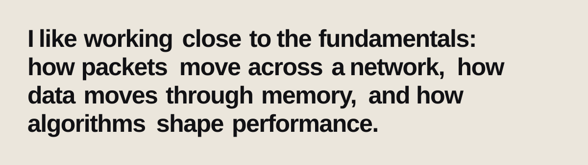

I'm an MEng Computer Engineering student at the **University of Ioannina**, based in **Thessaloniki, Greece**.

- **IT Systems Administrator Intern, Masoutis S.A. (2025).** Rolled out Zabbix monitoring across **22,000+ sensors**, with SNMP traps and triggers, and configured VLANs on Cisco RV and HPE Aruba CX 6000 switches.
- **IT Support Technician, University of Ioannina CSE Dept. (2022 to 2025).** Kept the department's systems running and built tools for students and staff.
- Now building security and systems tooling for Linux servers. I speak Greek, English and French.

### Selected work

| Project | What it does | Stack |
|---|---|---|
| [**Pylos**](https://github.com/Hanocybous/pylos) | SSH intrusion autoblocker: watches systemd journals for failed logins and bans attackers with iptables/ip6tables. SQLite persistence, ban expiry, CIDR whitelisting, Debian packaging. | Python, Linux |
| [**K-Clique App**](https://github.com/Hanocybous/k-clique-app) | Full-stack K-Clique solver using SAT (Z3), with k-core graph pruning for a 16,000x speedup and a 3D React visualizer. | Python, React |
| [**Parallel Systems & Programming**](https://github.com/Hanocybous/parallel-systems-and-programming-course) | Shared memory (OpenMP), GPU (CUDA, OpenMP offloading) and distributed memory (MPI) programming. | C, CUDA |
| [**G++ Compiler**](https://github.com/Hanocybous/gpp-compiler) | A compiler for a custom language: lexing, syntax analysis and error handling. | Python |
| [**Branch Prediction Simulator**](https://github.com/Hanocybous/computer-architecture-ii-course) | Branch predictor and cache simulation with Intel Pin on PARSEC benchmarks. | C++ |
| [**Gantt Chart Visualizer**](https://github.com/Hanocybous/gantt-chart-visualizer) | Desktop app for managing project timelines, tasks and dependencies. | Java, Swing |

  

**[Portfolio](https://hanocybous.github.io)** &nbsp;&nbsp; **[LinkedIn](https://www.linkedin.com/in/charilaoschatz/)** &nbsp;&nbsp; **[Email](mailto:charilaoschatzidimitriou@gmail.com)** &nbsp;&nbsp; **[dev.to](https://dev.to/hanocybous)** &nbsp;&nbsp; **[X](https://twitter.com/charilaoschatz)**
